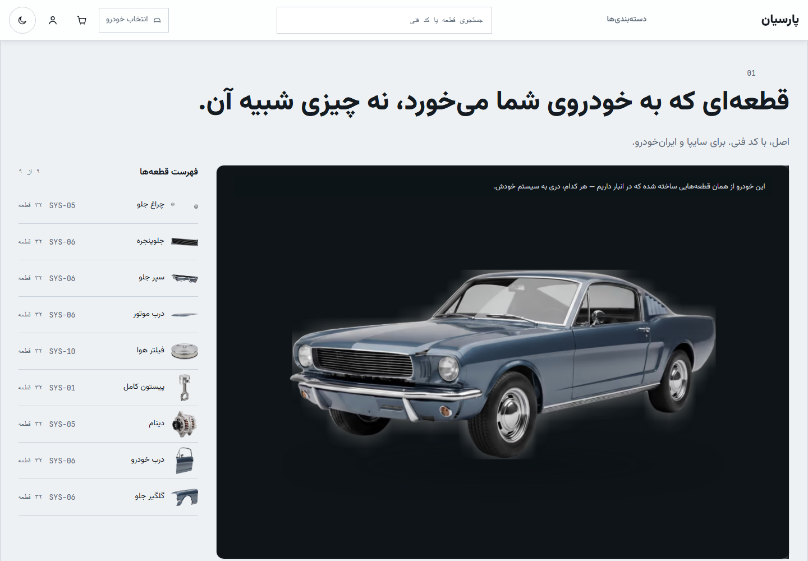
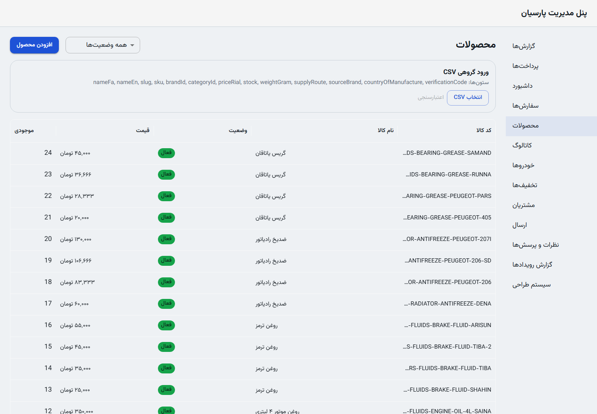

# ParsianStore

A Persian-first car-parts storefront for drivers and repair shops buying parts for **Saipa and Iran Khodro** vehicles. It connects vehicle fitment, retail/wholesale pricing, inventory and order management in one RTL application.

**Status:** client work in final development, awaiting eNAMAD and payment-gateway onboarding. Mock payment and Zarinpal sandbox implementations exist; commercial launch and production payments remain unverified. VPS setup is part of the work, with launch tasks still open.



## My contribution

I'm **Ramtin Farzane**. I developed the frontend, backend and database, containerized the application on Windows, and worked on VPS setup. The project is owned by **Ash Tech Group**.

The application includes product/category browsing and search, vehicle fitment, cart and checkout, customer addresses/orders/wishlist/garage, and staff tools for catalog, inventory and orders. The [verification note](docs/artifacts/github-showcase-verification.md) distinguishes implementation descriptions from checks performed in this pass.

## Two implementation decisions

- **Snapshot an order at checkout.** The [checkout service](apps/api/src/modules/checkout/checkout.service.ts) stores product names, prices, delivery details and shipping choices on the order, and creates its order/payment rows in a database transaction. Recorded purchase details remain independent of later catalog/address edits. Stock reservation and gateway failures have cleanup paths; external steps do not all share that transaction.
- **Keep payment providers replaceable.** A [provider factory](apps/api/src/providers/payment/index.ts) selects mock or Zarinpal through a common interface. Development can use mock payments while merchant onboarding is pending. Selecting Zarinpal requires merchant configuration; sandbox behavior is distinct from production payment verification.

## Stack and layout

Next.js 15, React 19 and TypeScript; Express 5 and Zod; PostgreSQL 18 with Prisma 7; Tailwind CSS for the storefront and MUI for staff screens. pnpm workspaces and Turborepo connect `apps/web`, `apps/api`, `packages/schemas` and `packages/config`.

Persian is the maintained product locale. English routing remains, but translation coverage is not maintained. `legacy/` is a frozen prototype outside the active workspace.

## Run locally

Use **Node 22** (`.nvmrc`), **pnpm 9.15.9** (`packageManager`) and isolated **PostgreSQL 18**. The [local development guide](docs/local-development.md) covers environment variables, migrations, synthetic seeds and startup without private agent instruction files.

This pass reproduced installation, migrations, seeds and checks on Node 24.11.1; Node 22 remains the declared CI target.

```bash
git clone https://github.com/boyInShadows/ParsianStore.git
cd ParsianStore
pnpm install --frozen-lockfile
```

Configure the environment and database before running the remaining setup commands in the guide. A reachable database alone does not mean migrations or seed data are present.

## Verification and visuals

Existing checks: `pnpm lint`, `pnpm typecheck`, `pnpm test`, `pnpm build` and `pnpm e2e`. Database tests require a separate database ending in `_test` and truncate test data. See [dated results and limits](docs/artifacts/github-showcase-verification.md).

The screenshots show the running production web build with an isolated, seeded database. Staff authentication used mock SMS; product rows are illustrative seed data.



## Further reading and limitations

- [Local development and review](docs/local-development.md)
- [Container/VPS deployment runbook](docs/deployment.md)
- [Remaining implementation and launch work](tasks.md)
- [Architecture and delivery decisions](masterPlan.md)

The deployment runbook contains operator procedures; it does not establish a public deployment. Use mock services for review. Existing ownership notices and bundled asset/font credits remain applicable; no new license or customer publication right is asserted.

پارسیان‌استور یک فروشگاه فارسی و راست‌به‌چپ برای قطعات خودروهای سایپا و ایران‌خودرو است. توسعه رابط کاربری، بک‌اند و پایگاه داده را انجام داده‌ام. پروژه هنوز پیش از عرضه تجاری است و راه‌اندازی پرداخت واقعی به دریافت اینماد و تکمیل فرایند درگاه پرداخت وابسته است.
